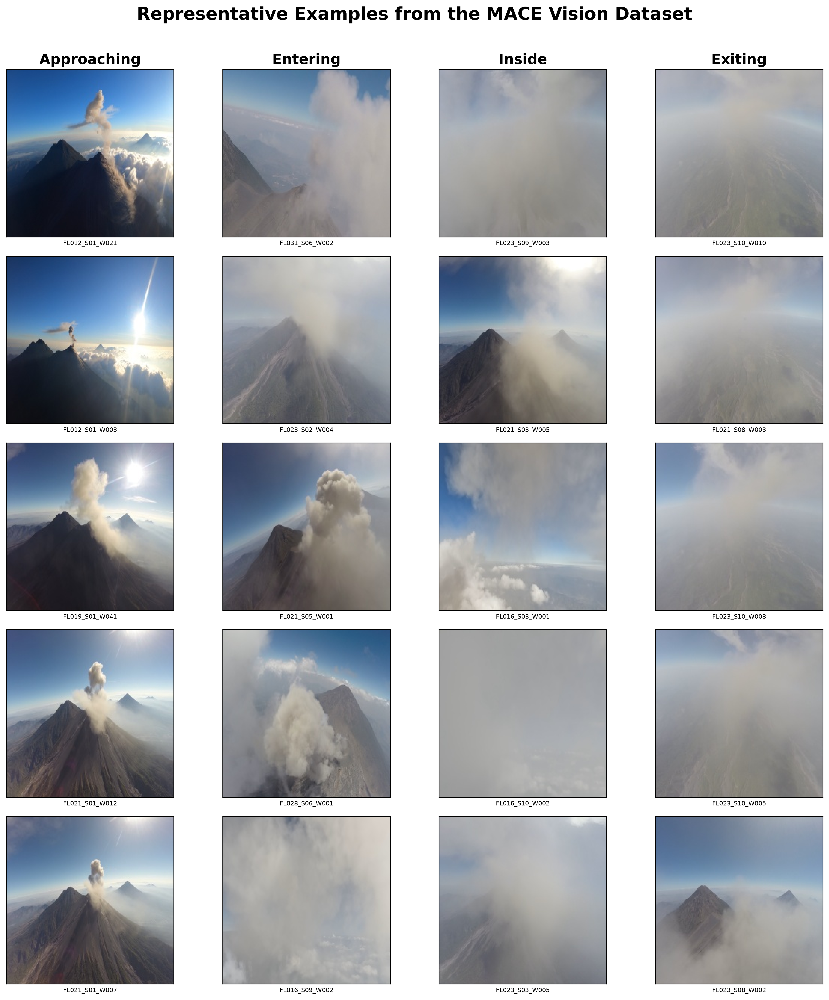

# Towards Multimodal Spatiotemporal Learning of UAV–Environment Interactions for Autonomous Perception

**Research code accompanying a manuscript submitted to the IEEE Aerospace Conference 2027.**

This repository contains selected implementations from research on **temporally aware UAV–environment perception** using synchronised onboard video and aircraft telemetry. The case study concerns fixed-wing UAV encounters with volcanic plumes at Volcán de Fuego, Guatemala.

Rather than detecting the presence of a plume alone, the work investigates how an aircraft's relationship with the environment evolves over time. It formulates recognition of four interaction states: **Approaching → Entering → Inside → Exiting**.



## Research overview

The study uses **12 operational fixed-wing flights** with **75 annotated interaction segments** (approximately **1,996 seconds**). It develops a temporal evaluation pipeline in which flights are partitioned before observation windows are generated, helping avoid leakage between training and evaluation samples. The principal classification setting uses **five-second observations**.

The research investigates three complementary approaches:

1. **Video-based perception:** spatiotemporal visual representations for recognising the four interaction states.
2. **Aircraft-state modelling:** temporal representations of onboard flight signals, including dynamics associated with plume encounters.
3. **Multimodal fusion:** cross-attention between visual and telemetry representations, including a **residual-gated** approach that retains the visual pathway while selectively incorporating aircraft-dynamic cues.

## Main results

The following **validation** results are reported in the final submitted manuscript. The fusion comparison uses the strongest MViTv2-S visual checkpoint trained with 4,000 sampled observations per epoch.

| Model | Validation accuracy | Validation Macro-F1 |
| --- | ---: | ---: |
| Vision-only MViTv2-S (matched baseline) | 0.7480 | 0.7500 |
| Residual-gated cross-attention fusion | **0.7570** | **0.7629** |

Residual-gated fusion improves Macro-F1 by **0.0129** (1.29 percentage points) and accuracy by **0.0090** (0.90 percentage points) over the matched vision-only baseline.

The paper also reports a validation Macro-F1 of **0.4034** for aircraft telemetry on the four-state task and **0.7860** for a separate binary low-/high-disturbance task. These are different classification tasks and should not be compared as equivalent benchmarks.

**Interpretation and limitations.** Video-native spatiotemporal representations more directly capture semantic interaction stage, while aircraft telemetry provides complementary information about vehicle dynamics. The strongest remaining classification ambiguity is between *inside* and *exiting*. Causal whole-flight evaluation reveals implausible transitions that window-level metrics alone do not expose. The reported fusion improvement is a validation result, and generalisation requires evaluation across additional independent flights.

These are research evaluation results, not claims of deployment-ready autonomous plume navigation.

## Repository contents

This is a **curated research-code release**, not a complete archive of exploratory experiments.

```text
.
├── README.md
├── requirements.txt
├── Docs/
│   └── figures/
│       └── dataset_examples.png
└── scripts/
    ├── MACE_dataset_builder/        # Annotation conversion and visual dataset generation
    ├── MACE_flight/                 # Video–telemetry synchronisation and aircraft-state learning
    ├── MACE_models/                 # Visual dataset, model, training and evaluation code
    ├── multimodal/                  # Cross-attention fusion
    └── multimodal-residual-ex2/     # Residual-gated cross-attention fusion
```

The released files include selected implementations of the main processing and modelling components. Some scripts were originally developed for an HPC environment and may require adaptation of paths, configuration and job execution to run elsewhere. **This release has not been packaged as a one-command reproducibility benchmark.**

## Getting started

A Python environment with the dependencies specified in `requirements.txt` is required. For example:

```bash
python -m venv .venv
source .venv/bin/activate
pip install -r requirements.txt
```

Review the selected scripts and configure their data paths, input formats and model checkpoints as appropriate. The original flight dataset and pretrained checkpoints are **not included**, so end-to-end reproduction of the paper's results is not possible from this repository alone.

## Data and model availability

Raw flight videos, aircraft telemetry, processed datasets, trained weights and experiment outputs are **not distributed** in this repository. Their absence should not be interpreted as a commitment to provide unrestricted access. Any data-sharing request is subject to the applicable permissions and agreements.

## Associated paper

**Ikechukwu Ofodile, Tilo Burghardt, Matthew Watson, and Thomas Richardson.**  
*Towards Multimodal Spatiotemporal Learning of UAV–Environment Interactions for Autonomous Perception.*  
**Manuscript submitted to IEEE Aerospace Conference 2027.**

The manuscript is **submitted, not yet accepted or published**. A public paper link, DOI and formal proceedings citation will be added only when available and authorised.

## Contact

**Ikechukwu Ofodile**  
University of Bristol  
[Research website](https://ic-ofodile-bristol.github.io/personal_page/)

## Licence

No open-source licence has been assigned to this repository at present. Public visibility does not by itself grant permission to reuse or redistribute the code. A licence may be added after the relevant permissions have been confirmed.
